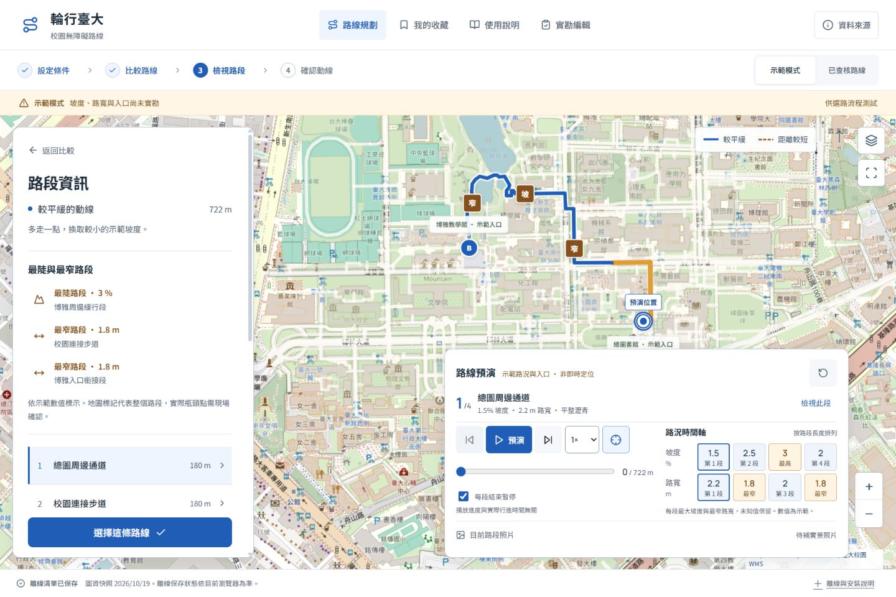

# 輪行臺大 WHEELWAY

第 11 組輪椅友善路徑導航系統的 Web App 原始碼。依 Proposal-2 與 Project Handout v4 製作，支援「設定條件 → 比較路線 → 檢視路段 → 確認動線」。

公開測試網址：https://ntu-wheelway-11.brainyshell5.chatgpt.site/

Public GitHub repo：https://github.com/Alanchou888/ntu-wheelway-11

## 目前開發狀態

此 repository 包含 v2.2 校園試用版的程式碼。公開測試站的部署進度獨立管理，不能由 package 版本推定已上線。前端使用滿版地圖、浮動資訊面板與藍／棕兩種路線標示。

- 新增路段社群回報：公開閱讀，登入後可發布文字與照片、確認現況、檢舉與撤回。D1 與 R2 提供跨裝置共用儲存，使用者回報持續與實勘證據分開。詳見 [v2.2 社群路況](docs/v2.2-社群路況.md)。
- 新增路線預演：沿道路幾何播放、逐段暫停、前後跳段、1×／2×／4× 速度及鍵盤進度操作。手機播放時會收合面板。
- 新增互動路況時間軸：按路段距離排列坡度與路寬，選段會同步更新地圖、說明與照片。未知值保留，資料不完整時不判定全程極值。
- 手機可用按鈕、把手拖曳或鍵盤調整面板高度。拖動地圖會解除預演跟隨，背景自動暫停，系統減少動態時保留手動查看。

- 可選擇坡度、路寬、階差與查核期限，條件會保留於分享連結。
- 收藏及偏好保存在目前瀏覽器，可移除收藏並復原。
- 實勘編輯器增加輸入驗證、保存狀態與多分頁寫入衝突保護。
- 照片可逐張檢視及放大，確認路線頁提供列印版面。
- 正式建置產生離線外殼與同版本資料快取，不快取外部地圖圖磚。
- 提供實勘 JSON 審查及本地資料發布工具，流程見 [實勘發布流程](docs/實勘發布流程.md)。

v2.0 的 93 項自動測試與 16 項瀏覽器主要流程檢查保留於 [產品檢查與改善](docs/產品檢查與改善.md) 與 [驗證資料](docs/evidence/v2-ui-qa.json)。v2.1 新增預演幾何、暫停邊界、反向路線、未知值與減少動態的測試，驗證範圍見 [v2.1 操作與驗證](docs/v2.1-路線預演.md)。實際受測者測試、完整輔助科技檢查與真實路況實勘仍待團隊執行。

公開原始碼不包含實際受測者紀錄、本機 IndexedDB 草稿、使用者照片、API 憑證或課程 PDF。公開已查核路線目前為空，需由團隊實勘及審核後接入。



## 前端設計規則

- [DESIGN.md](DESIGN.md) 記錄字級、色彩、配置、互動與選用 skill 的版本。
- [前端美化提示詞](docs/前端美化提示詞.md) 可直接用於後續修改。
- 實作時使用 Anthropic Frontend Design 與 UI UX Pro Max，已排除不適合地圖工具的行銷頁建議。
- Skill 安裝於開發者本機，不屬於執行網站的必要依賴。

## v1.1 新增

- 實勘編輯器：右上角「實勘編輯」可建立兩條空白動線草稿，逐段填寫量測、入口座標、照片、來源及日期。支援目前瀏覽器自動儲存、JSON 匯入匯出與 CSV 彙整。
- 差異摘要：比較表直接呈現距離、最大坡度及最窄路寬，以及多走多少公尺、坡度差幾個百分點、路寬差多少公尺。
- 瓶頸標記：標出所選路線最陡與最窄的路段，保留並列情況。地圖標記與清單可互相切換，地圖標記支援 Enter 與空白鍵。

草稿只存在當前瀏覽器的 IndexedDB，公開網址不包含本機草稿。網站不會自動發布草稿。將 JSON 交給團隊審核後，才可接入公開的已查核路線。清除網站資料或更換裝置會失去本機紀錄，請定期匯出備份。

## 啟動

建議使用 Node.js 24，專案保留 npm lockfile。

```powershell
npm.cmd ci
npm.cmd run build
npm.cmd run db:local
npm.cmd run dev:api
```

開啟 `http://127.0.0.1:8787/` 查看正式建置與本機 API。前端開發可另開終端執行 `npm.cmd run dev -- --host 127.0.0.1`，開啟 `http://127.0.0.1:5173/`，可使用本機模擬登入。檢查與重新建置：

```powershell
npm.cmd test
npm.cmd run typecheck
npm.cmd run build
npm.cmd run preview
```

網站包含 `dist/client` 前端、`dist/server` Worker 與 `dist/.openai` 發布資訊。社群功能需要 Sites 的 D1 與 R2，相關設定見 v2.2 文件。網址以 hash 保存畫面、起終點、輪椅類型、偏好及路線，可直接分享與重新開啟。

## 初版資料

預設示範模式的道路幾何來自 OpenStreetMap，兩條動線約 512 公尺與 722 公尺。坡度、路寬、路面、階差與入口標示為示範，查核日期均留空。臺大 API 的建物中心用於定位，未視為無障礙入口。輪行臺北周邊 18 個公開斜坡道點位的未知值保留為 null。

已查核模式目前沒有實勘路線，會顯示「目前無已查核路線」。可在資料來源視窗查看各公開來源與取得日期。地圖圖層失敗時仍可使用資料快照、向量背景與路段清單，未提供圖磚離線下載。

## 團隊後續工作

- [圖資更新與實勘資料接入](docs/資料維護.md)
- [空白使用者測試與設計決策紀錄](docs/使用者測試紀錄.md)
- [空白實勘 CSV](public/templates/field-survey.csv)
- 執行 `npm.cmd run survey:template` 可建立可編輯的路線 JSON 範本。

實勘、使用者訪談與正式測試結果需由團隊實際蒐集。程式測試不代表已完成課程要求的受測者測試。

## 技術與 AI 使用紀錄

使用 React、TypeScript、Vite、Leaflet 與 Lucide，社群服務使用 Cloudflare Workers、D1 與 R2。瀏覽路線與公開回報無需登入，發布與確認使用 ChatGPT 登入，無需自行提供付費地圖 API key。實勘草稿仍以瀏覽器 IndexedDB 儲存。

本版由 AI 協助實作介面、公開資料處理及程式驗證。保留提案的四步流程，使用滿版地圖、浮動面板與出發前路線預演。未有實勘照片的區塊保留缺圖提示。示範模式與查核模式分開，避免將模擬數值誤認為通行證據。這些實作選擇仍待真實使用者測試與團隊迭代。

地圖來源：臺大校園公開 API 與 WMS、OpenStreetMap contributors（ODbL）、臺北市輪行臺北設施 API。各筆來源網址與取得日期保存在資料快照中。

## 重跑瀏覽器驗證

啟動開發伺服器後，另開終端執行。需要已安裝 Chrome 的環境，輸出截圖會寫入 `output/playwright/`。

```powershell
npx.cmd --yes --package @playwright/cli playwright-cli -s=wheelway open http://localhost:5173/
npx.cmd --yes --package @playwright/cli playwright-cli -s=wheelway run-code --filename scripts/browser-qa.js
npx.cmd --yes --package @playwright/cli playwright-cli -s=wheelway run-code --filename scripts/browser-v11-qa.js
npx.cmd --yes --package @playwright/cli playwright-cli -s=wheelway run-code --filename scripts/browser-failure-qa.js
npx.cmd --yes --package @playwright/cli playwright-cli -s=wheelway run-code --filename scripts/accessibility-qa.js
npx.cmd --yes --package @playwright/cli playwright-cli -s=wheelway close
```

`browser-failure-qa.js` 會故意模擬 HTTP 錯誤、圖層故障與圖片遺失，因此瀏覽器網路紀錄會出現預期錯誤。腳本會檢查介面復原、清單可用性及未捕捉的 JavaScript 例外。`browser-v11-qa.js` 會在獨立的自動測試瀏覽器填入明確標示的程式測試資料，檢查本機儲存、照片與匯入匯出，測試資料僅寫入忽略的 `output/`，不放入公開實勘資料。自動無障礙檢查使用 axe-core，不能取代真實輔助科技與使用者測試。
